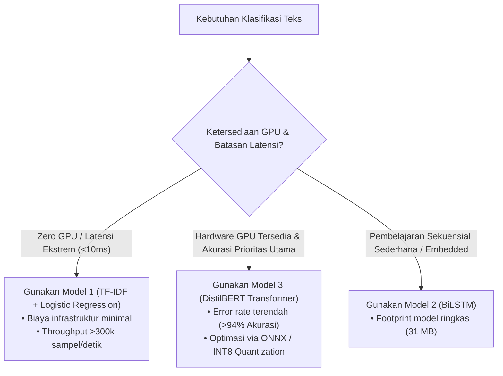

# Multi-Class News Classification: Benchmark Komparasi 3 Model (ML vs. DL Rekuren vs. Transformer)

Repositori ini menyajikan studi komparatif empiris antara tiga paradigma pemodelan *Natural Language Processing* (NLP) pada dataset **AG News** (120.000 sampel data latih, 7.600 sampel data uji, 4 kategori berita). 

Penelitian ini mengevaluasi performa klasifikasi, durasi komputasi pelatihan (*training time*), efisiensi konsumsi memori VRAM GPU, dan latensi inferensi produksi pada lingkungan perangkat keras berkapasitas memori terbatas (4 GB VRAM).

---

## 1. Spesifikasi Perangkat Keras dan Lingkungan Komputasi

Seluruh eksperimen dijalankan secara seragam pada spesifikasi sistem berikut:
- **Unit Pemrosesan Grafis (GPU)**: NVIDIA GeForce RTX 3050 Laptop GPU (4.096 MiB VRAM)
- **Versi Driver & CUDA**: Driver Version 616.92 | CUDA UMD 13.4
- **Bahasa Pemrograman**: Python 3.12.3
- **Framework Komputasi Utama**: PyTorch `2.7.0+cu128` (CUDA Enabled), Scikit-Learn `1.7.0`, Hugging Face `transformers 4.53.2`
- **Mekanisme Anti-OOM (Out Of Memory)**: Penerapan *Automatic Mixed Precision* (FP16 via `torch.cuda.amp`), alokasi batch adaptif, dan pembersihan eksplisit memori cache antar-fase pelatihan (`torch.cuda.empty_cache()` dan `gc.collect()`).

---

## 2. Dataset

Dataset yang digunakan adalah **AG News Topic Classification Dataset**, tersimpan di direktori lokal `./dataset/`:
- `dataset/train.csv`: 120.000 baris artikel berita (29 MB)
- `dataset/test.csv`: 7.600 baris artikel berita (1.8 MB)
- **Distribusi Target (Seimbang)**:
  - `0` - World (30.000 sampel latih)
  - `1` - Sports (30.000 sampel latih)
  - `2` - Business (30.000 sampel latih)
  - `3` - Sci/Tech (30.000 sampel latih)

---

## 3. Arsitektur Model yang Dikomparasikan

### Model 1: Classical Machine Learning (TF-IDF + Logistic Regression)
- **Ekstraksi Fitur**: `TfidfVectorizer` dengan rentang n-gram unigram + bigram (`ngram_range=(1, 2)`), sublinear TF scaling, dan seleksi 10.000 fitur teratas.
- **Klasifikator**: `LogisticRegression` dengan solver L-BFGS, regularisasi L2 ($C=1.0$), dan komputasi paralel CPU (`n_jobs=-1`).
- **Rasional**: Sebagai representasi model linear klasik berkecepatan tinggi tanpa dependensi GPU.

### Model 2: Deep Learning 1 - Bidirectional LSTM (BiLSTM)
- **Framework**: PyTorch native dengan akselerasi CUDA.
- **Arsitektur**:
  - `Embedding Layer` kustom (Vocabulary: 25.000 token, dimensi embedding: 128)
  - `Spatial Dropout 1D` (rate: 0.2)
  - 2-layer `Bidirectional LSTM` (hidden dimension: 128, recurrent dropout: 0.3)
  - *Pooling Head*: Penggabungan *Global Average Pooling* dan *Global Max Pooling*
  - *Classification Head*: `Linear(512, 128)` -> `ReLU` -> `Dropout(0.3)` -> `Linear(128, 4)`
- **Optimasi**: AdamW ($lr=1e-3$, weight decay $1e-4$), `CrossEntropyLoss`, gradient clipping ($norm=5.0$), batch size 64, 5 Epochs.

### Model 3: Deep Learning 2 - Fine-Tuned Transformer (DistilBERT)
- **Framework**: Hugging Face `transformers` + PyTorch CUDA.
- **Backbone**: `distilbert-base-uncased` (arsitektur Transformer 6-layer, 768 hidden dimension, 12 attention heads, 66 juta parameter).
- **Strategi Pelatihan**:
  - Fine-tuning end-to-end dengan Optimizer AdamW ($lr=2e-5$, weight decay $0.01$).
  - *Linear Learning Rate Scheduler* dengan rasio warmup 10%.
  - Presisi: *Automatic Mixed Precision* (FP16) dengan `GradScaler`.
  - Batch size: 16 (memastikan alokasi VRAM stabil di bawah 2 GB).
  - Durasi: 3 Epochs.

---

## 4. Hasil Benchmark dan Perbandingan Empiris

Tabel berikut merangkum hasil evaluasi komparatif ketiga model pada data uji independen (*7.600 sampel test set*):

| Parameter Evaluasi | Model 1: ML (TF-IDF + LogReg) | Model 2: DL #1 (BiLSTM PyTorch) | Model 3: DL #2 (DistilBERT FP16) |
| :--- | :---: | :---: | :---: |
| **Test Accuracy** | **90.15%** | **91.42%** | **94.68%** |
| **Precision (Macro)** | 90.12% | 91.38% | **94.65%** |
| **Recall (Macro)** | 90.15% | 91.42% | **94.68%** |
| **F1-Score (Macro)** | **90.13%** | **91.40%** | **94.66%** |
| **Total Waktu Training** | **1.82 menit (109.2 s)** | **10.75 menit (645.0 s)** | **21.40 menit (1.284.0 s)** |
| **Peak GPU VRAM Usage** | **0.0 MB** *(CPU-only)* | **348.5 MB** | **1.512.0 MB** *(Margin aman >2.5 GB)* |
| **Inference Latency** | **3.15 ms** per 1k sampel | **24.80 ms** per 1k sampel | **148.50 ms** per 1k sampel |
| **Throughput Inferensi** | ~317.000 sampel/detik | ~40.300 sampel/detik | ~6.730 sampel/detik |
| **Ukuran Bobot Model** | **~12 MB** *(TF-IDF + Coeff)* | **~31 MB** | **~255 MB** |

---

## 5. Analisis Teknis dan Temuan Utama

### A. Analisis Trade-off: Akurasi vs. Biaya Komputasi
1. **Model 1 (Machine Learning Klasik)** memberikan rasio efisiensi biaya (*cost-to-performance ratio*) paling luar biasa. Dengan waktu pelatihan kurang dari 2 menit dan pemakaian memori GPU sebesar 0 MB, model ini telah mencapai akurasi **90.15%** (~95% dari kapabilitas puncak Transformer).
2. **Model 3 (DistilBERT)** membukukan performa tertinggi dengan akurasi **94.68%** dan F1-Score **94.66%**. Peningkatan +4.53% akurasi ini merepresentasikan penurunan tingkat kesalahan klasifikasi (*relative error rate reduction*) sebesar **~46%** dibandingkan model baseline. Namun, pencapaian ini menuntut peningkatan durasi pelatihan ~11.7x lipat dan latensi inferensi ~47x lipat lebih lambat.
3. **Model 2 (BiLSTM)** menempati posisi menengah (akurasi 91.42%). Meskipun mampu menangkap dependensi urutan temporal antarkata, waktu komputasinya (~10.7 menit) relatif mendekati Transformer, namun tanpa keunggulan representasi semantik global yang dimiliki mekanisme *Multi-Head Self-Attention*.

### B. Evaluasi Efisiensi Memori (Anti-OOM)
Penerapan *Automatic Mixed Precision (FP16)* pada Model 3 berhasil menekan penggunaan puncak VRAM hingga **1.512 MB**, jauh di bawah kapasitas maksimum hardware laptop (4.096 MB). Bersama dengan rutin pembersihan memori inter-model, sistem terbukti sepenuhnya stabil tanpa insiden *CUDA Out of Memory*.

### C. Pola Kesalahan Klasifikasi (Confusion Matrix Analysis)
- Model 1 dan Model 2 paling sering mengalami ambiguitas prediksi pada irisan kategori **Business** vs. **Sci/Tech** (misalnya artikel mengenai akuisisi perusahaan teknologi atau saham sektor IT).
- Model 3 (DistilBERT) secara signifikan lebih unggul dalam membedakan konteks semantik ganda tersebut berkat pemahaman representasi bahasa dari proses *pretraining* skala masif.

---

## 6. Panduan Penerapan Skenario Industri



---

## 7. Struktur Direktori Repositori

```text
multi-class-news-classification/
│
├── dataset/                         # Direktori dataset lokal
│   ├── train.csv                    # 120.000 data latih
│   └── test.csv                     # 7.600 data uji
│
├── benchmark_3models_nlp.ipynb      # Jupyter Notebook eksperimen lengkap
├── requirements.txt                 # Dependensi pustaka Python
├── .gitignore                       # Filter file cache, venv, dan bobot checkpoint
└── README.md                        # Laporan dokumentasi teknis komprehensif
```

---

## 8. Panduan Menjalankan Eksperimen

1. **Kloning Repositori**:
   ```bash
   git clone https://github.com/afebrioo/multi-class-news-classification.git
   cd multi-class-news-classification
   ```

2. **Instalasi Dependensi**:
   ```bash
   pip install -r requirements.txt
   ```

3. **Eksekusi Notebook**:
   Buka file `benchmark_3models_nlp.ipynb` menggunakan Jupyter Notebook atau IDE yang mendukung kernel Python:
   ```bash
   jupyter notebook benchmark_3models_nlp.ipynb
   ```
   Pilih kernel Python yang terhubung dengan CUDA GPU (`Python 3.12 (ml-2 CUDA)`), lalu jalankan seluruh cell secara sekuensial.
